# Tugas-UTS-PemrogramanWEB1
# TOKO BUKU ONLINE

## UJIAN TENGAH SEMESTER (UTS)
**Mata Kuliah:** Pemrograman Web 1

---

## 1. Deskripsi Project

Toko Buku Online merupakan sebuah website sederhana yang dibuat untuk memenuhi tugas Ujian Tengah Semester (UTS) mata kuliah Pemrograman Web 1.

Website ini dirancang untuk membantu proses pengelolaan toko buku secara online, mulai dari melihat katalog buku, mengetahui informasi stok, melakukan pemesanan, mengelola keranjang belanja, melakukan checkout, hingga melacak status pengiriman pesanan.

Website ini juga dilengkapi dengan fitur laporan pemesanan dan history transaksi untuk membantu admin melihat ringkasan serta riwayat transaksi yang telah dilakukan.

## 2. Tujuan Pembuatan

Tujuan pembuatan website Toko Buku Online adalah:

1. Menerapkan penggunaan HTML untuk membuat struktur halaman website.
2. Menerapkan CSS untuk mengatur tampilan dan desain website.
3. Menerapkan JavaScript untuk membuat website menjadi interaktif.
4. Membuat sistem login dan pendaftaran akun.
5. Membuat sistem katalog dan pengelolaan stok buku.
6. Membuat fitur pemesanan dan checkout buku.
7. Membuat fitur tracking pengiriman.
8. Membuat laporan pemesanan dan history transaksi.

## 3. Teknologi yang Digunakan

Dalam pembuatan website ini menggunakan beberapa teknologi berikut:

- **HTML5:** Digunakan untuk membuat struktur dan elemen halaman website.
- **CSS3:** Digunakan untuk mengatur desain, warna, tata letak, dan tampilan website.
- **JavaScript:** Digunakan untuk mengatur proses login, pendaftaran, katalog, keranjang, checkout, transaksi, dan tracking.
- **LocalStorage:** Digunakan untuk menyimpan data pengguna tambahan dan transaksi pada browser.
- **Visual Studio Code:** Digunakan sebagai aplikasi untuk menulis dan mengedit kode program.
- **Live Server:** Digunakan untuk menjalankan website melalui browser.

## 4. Fitur Website

### A. Login
Digunakan oleh pengguna untuk masuk ke dalam website menggunakan email dan password yang telah terdaftar.
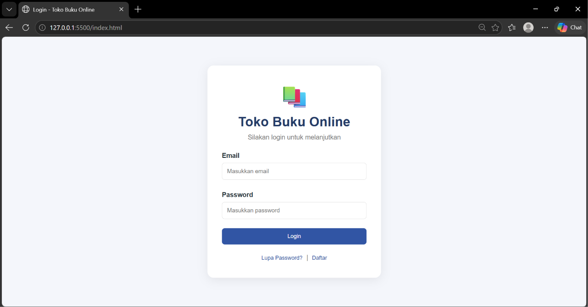

### B. Pendaftaran Akun
Digunakan untuk membuat akun pengguna baru dengan mengisi nama, email, dan password.
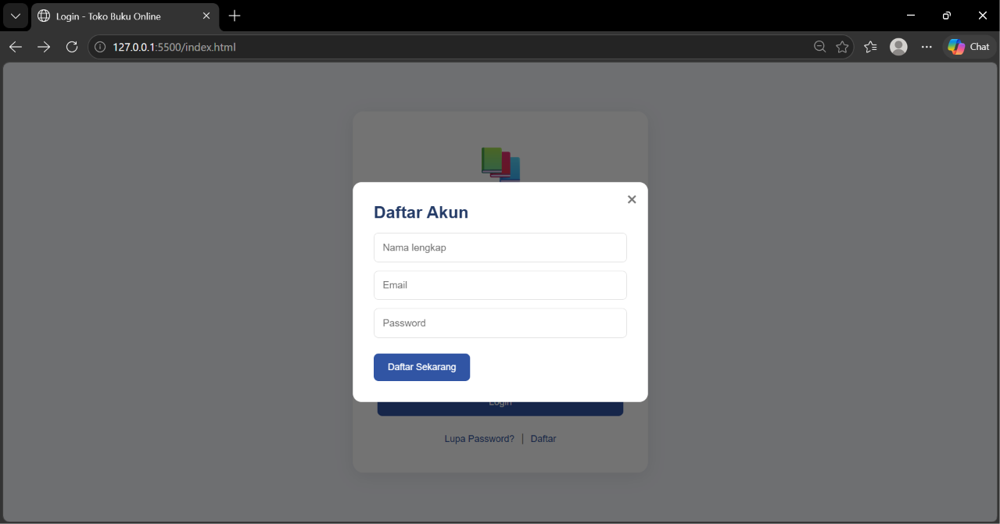

### C. Lupa Password
Digunakan untuk membantu pengguna yang lupa password. Sistem akan memeriksa apakah email terdaftar dan memberikan informasi untuk menghubungi admin.
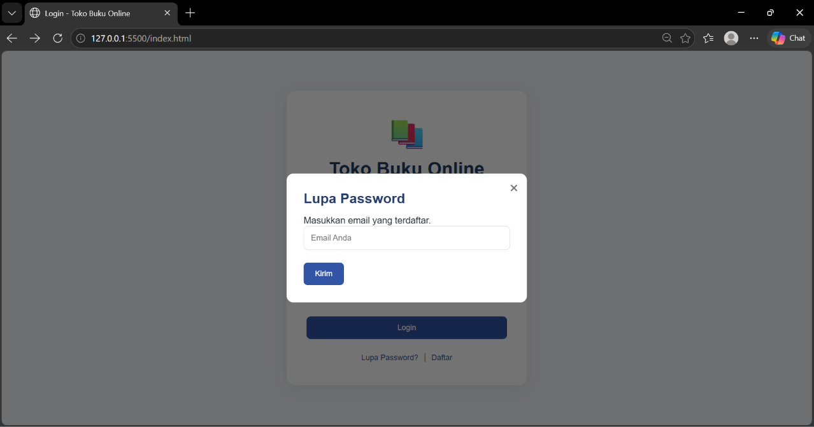

### D. Dashboard
Merupakan halaman utama setelah pengguna berhasil login. Dashboard menampilkan ucapan selamat datang dan menu utama website.
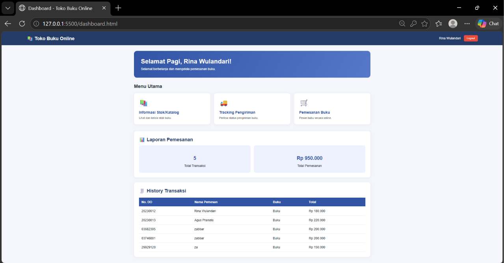

### E. Informasi Stok dan Katalog Buku
Menampilkan informasi buku yang tersedia, seperti:
- Gambar sampul buku.
- Kode barang.
- Nama buku.
- Jenis barang.
- Edisi buku.
- Jumlah stok.
- Harga buku.

Admin juga dapat menambahkan data buku baru melalui fitur tambah buku.
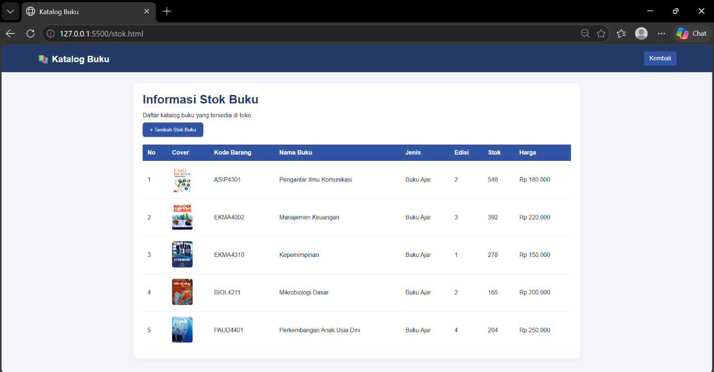
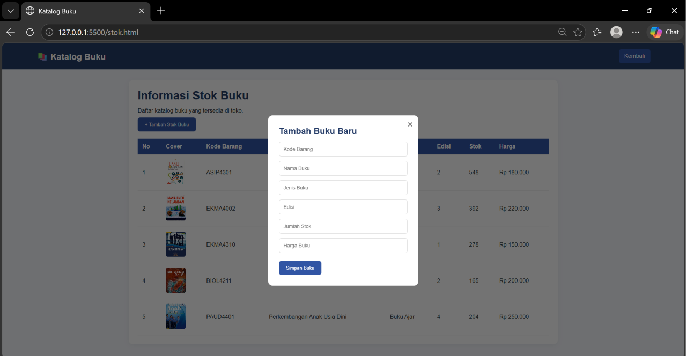

### F. Pemesanan Buku
Digunakan untuk memilih buku yang ingin dibeli dan memasukkannya ke dalam keranjang belanja.
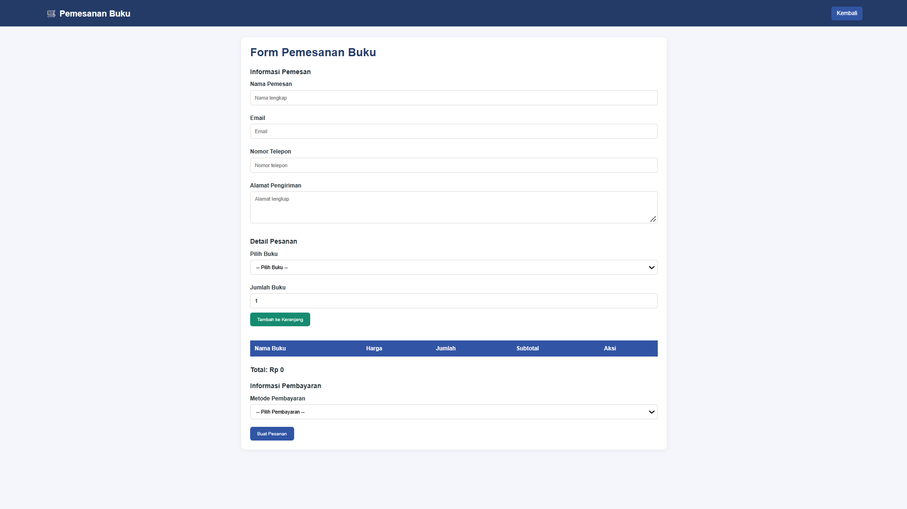

### G. Keranjang Belanja
Menampilkan buku yang telah dipilih, harga, jumlah pembelian, dan subtotal. Pengguna dapat mengubah jumlah buku atau menghapus buku dari keranjang.
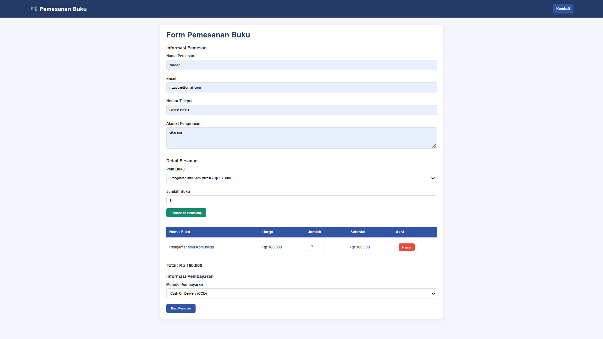

### H. Checkout
Digunakan untuk menyelesaikan proses pemesanan dengan mengisi data pemesan, seperti nama, email, nomor telepon, alamat, dan metode pembayaran.

Sistem akan memeriksa stok buku sebelum menyimpan transaksi.


### I. Tracking Pengiriman
Digunakan untuk mengetahui informasi dan status pengiriman berdasarkan nomor Delivery Order (DO).

Informasi yang ditampilkan meliputi:
- Nomor DO.
- Nama pemesan.
- Nama buku.
- Status pesanan.
- Ekspedisi.
- Tanggal pengiriman.
- Total pembayaran.
- Riwayat perjalanan pengiriman.
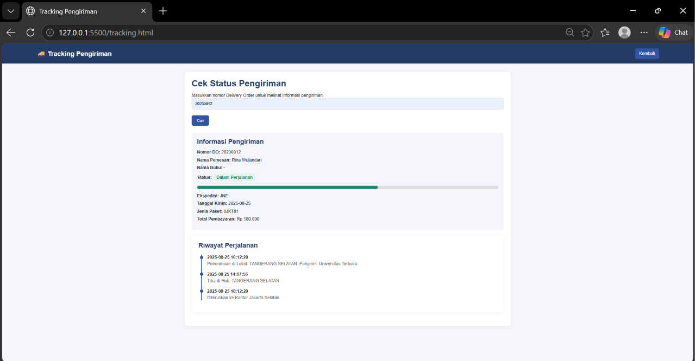

### J. Laporan Pemesanan
Menampilkan ringkasan transaksi berupa jumlah transaksi dan total nilai pemesanan.
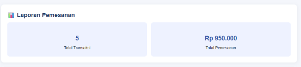

### K. History Transaksi
Menampilkan riwayat transaksi yang telah tercatat, meliputi nomor DO, nama pemesan, buku yang dipesan, dan total pembayaran.
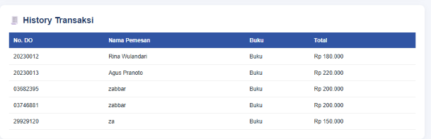

### L. Logout
Digunakan untuk keluar dari akun dan kembali ke halaman login.
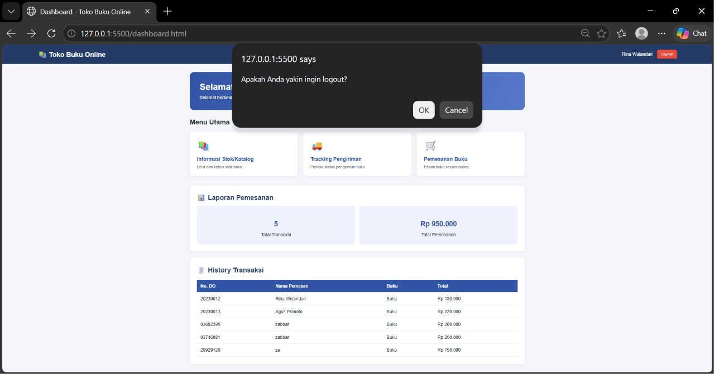

## 5. Struktur Folder Project

Berikut struktur folder dan file dalam project Toko Buku Online:

```text
tugas-uts-web1/
│
├── css/
│   └── style.css
│
├── img/
│   ├── pengantar_komunikasi.jpg
│   ├── manajemen_keuangan.jpg
│   ├── kepemimpinan.jpg
│   ├── mikrobiologi.jpg
│   └── paud_perkembangan.jpg
│
├── js/
│   ├── data.js
│   └── script.js
│
├── index.html
├── dashboard.html
├── stok.html
├── checkout.html
├── tracking.html
│
└── README.md
```

**Keterangan:**

- `index.html`: Halaman login, pendaftaran akun, dan lupa password.
- `dashboard.html`: Halaman utama website.
- `stok.html`: Halaman informasi katalog dan stok buku.
- `checkout.html`: Halaman pemesanan dan checkout buku.
- `tracking.html`: Halaman pelacakan pengiriman.
- `css/style.css`: File untuk mengatur tampilan website.
- `js/data.js`: File yang berisi data pengguna, katalog buku, dan data tracking.
- `js/script.js`: File yang berisi fungsi dan proses kerja website.
- `img/`: Folder untuk menyimpan gambar sampul buku.
- `README.md`: File dokumentasi project.

## 6. Data Pengguna untuk Login

Berikut akun yang dapat digunakan untuk mencoba website:

| Nama | Email | Password | Role |
|---|---|---|---|
| Rina Wulandari | rina@gmail.com | rina123 | User |
| Agus Pranoto | agus@gmail.com | agus123 | User |
| Siti Marlina | siti@gmail.com | siti123 | Admin |

**Catatan:** Role pengguna tersimpan pada data akun. Pembatasan akses berdasarkan role belum diterapkan secara khusus pada seluruh halaman.

## 7. Data Katalog Buku

Website memiliki lima data buku awal, yaitu:

| Kode Barang | Nama Buku |
|---|---|
| ASIP4301 | Pengantar Ilmu Komunikasi |
| EKMA4002 | Manajemen Keuangan |
| EKMA4310 | Kepemimpinan |
| BIOL4211 | Mikrobiologi Dasar |
| PAUD4401 | Perkembangan Anak Usia Dini |

Data katalog dapat digunakan untuk melihat informasi buku dan melakukan pemesanan.

## 8. Cara Menjalankan Website

Berikut langkah-langkah menjalankan website:

1. Buka aplikasi Visual Studio Code.
2. Pilih menu Open Folder.
3. Pilih folder `tugas-uts-web1`.
4. Pastikan seluruh file dan folder project sudah tersedia.
5. Buka file `index.html`.
6. Klik kanan pada file tersebut.
7. Pilih Open with Live Server.
8. Website akan terbuka secara otomatis melalui browser.
9. Masukkan email dan password untuk login.

## 9. Cara Menggunakan Website

1. Buka website melalui halaman login.
2. Masukkan email dan password yang sudah terdaftar.
3. Setelah berhasil login, pengguna akan masuk ke dashboard.
4. Pilih menu Informasi Stok/Katalog untuk melihat buku.
5. Pilih menu Pemesanan Buku untuk melakukan pemesanan.
6. Masukkan buku ke dalam keranjang.
7. Isi data pemesan pada halaman checkout.
8. Selesaikan pemesanan.
9. Simpan atau catat nomor DO yang diberikan sistem.
10. Buka menu Tracking Pengiriman untuk melihat status pesanan.
11. Kembali ke dashboard untuk melihat laporan dan history transaksi.
12. Tekan tombol Logout jika ingin keluar dari akun.

## 10. Penyimpanan Data

Website ini menggunakan JavaScript LocalStorage untuk menyimpan beberapa data pada browser.

Data yang disimpan antara lain:

- Data akun tambahan yang didaftarkan pengguna.
- Informasi pengguna yang sedang login.
- Data transaksi hasil checkout.

Data katalog dan data tracking awal disimpan pada file `data.js`.
---
